  

  <b>Nguyễn Hoàng Phúc</b> (PmSubin) 
  Creator &amp; Roblox Game Developer · Founder of <a href="https://typhupixel.com">Tỷ Phú Pixel</a> 
  IT student at UEH – University of Economics Ho Chi Minh City

  I make random things — Roblox games, browser games, AI apps — and lead a team that turns ideas into real digital products.

  &nbsp;
  &nbsp;
  

  

  

  <b>Tỷ Phú Pixel</b> — free-to-play 8-bit browser game with real-time chat, cloud saves and server-side anti-cheat. 
  <a href="https://typhupixel.com">typhupixel.com</a> · <a href="https://github.com/PmSubin/typhupixel">Release notes</a>

  

  <b>SUBEL Story Room</b> — AI character chat platform for Gemini, ChatGPT, Claude, OpenRouter, DeepSeek and Grok, in English, Vietnamese and Japanese. 
  <a href="https://pmsubin.github.io/subel-phongchat/">Live demo</a> · <a href="https://github.com/PmSubin/subel-phongchat">Source code</a>

  <b>Reel A Fish</b> — koi fishing game with 200 collectible koi, server-side catch odds and rebirth progression. Built with Luau and Rojo. 
  In development

  

  

  

